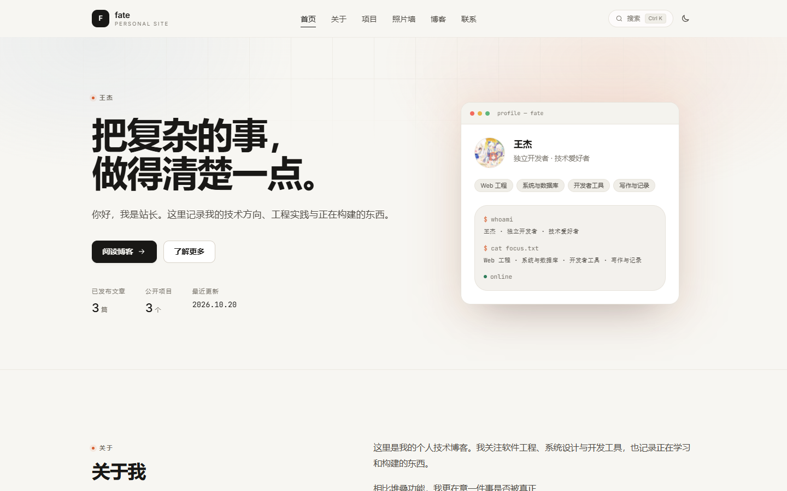

# 个人技术博客与内容管理系统

一个可实际运行、可自行托管的个人站点：面向访客的博客 / 作品集，以及带真实认证、文章 CRUD、Markdown 编辑与图片上传的管理后台。

> 当前目标是本地开发与浏览器验证。域名解析、VPS 和正式部署尚未执行；项目已经为 `https://fateway.cn` 的 HTTPS 部署预留配置。



---

## 1. 当前实现概览

### 前台

- 首页：Hero、个人介绍、技术方向、精选项目、最新文章、联系方式、页脚。
- 博客列表：服务端搜索（标题 / 摘要 / 正文）、分类筛选、标签筛选、分页。
- 文章详情：Markdown 正文、GFM 表格/任务列表、代码高亮、代码复制、自动目录、阅读进度、上一篇/下一篇。
- 关于、项目、联系页面；照片墙独立页面与相册详情页，关于页保留入口链接。
- 浅色 / 深色主题，跟随系统并持久化到 `localStorage`。
- 响应式：桌面、平板、移动端；移动端全屏导航；无横向溢出。
- RSS（浏览器访问显示主题化预览与文章列表，阅读器获取 XML）、`robots.txt`、`sitemap.xml`、canonical、Open Graph、JSON-LD、站点图标。
- 照片墙（顶部导航）：按相册分类展示，每个相册取前几张照片做叠放封面，进入详情页查看全部照片。

### 后台（默认 `/admin`，可配置）

- 管理员登录 / 退出、会话失效处理、未登录拦截。
- 仪表盘：文章总数、已发布、草稿、项目数、最近编辑、最近发布、系统状态（均来自真实数据库）。
- 文章管理：创建、编辑、删除、发布、下架、定时发布、草稿。
- Markdown 编辑器：实时预览、工具栏、图片插入、封面上传、slug、分类、标签、发布时间、Ctrl/⌘+S 保存、未保存提醒、请求竞态与冲突处理。
- 项目管理：增删改查、封面、链接、排序、前台可见性。
- 照片墙：按相册分类上传奖状/证书、标题与说明、排序、公开或隐藏；公开后展示在独立照片墙页面与相册详情页。
- 站点设置：站点信息、品牌标识（Logo 图片/文字与副标题）、Hero 文案、个人资料、头像、技能分组、原则与板块标题、社交链接、联系邮箱。
- 后台侧栏的头像、显示名称与站点名称会同步使用站点设置里的个人资料与站点名称，保存后即时更新。
- 账户安全：修改密码（scrypt）、注销其他会话。
- 图片上传：类型/大小/内容校验，服务端 re-encode 为 WebP，随机文件名，独立媒体目录。

### 安全机制

- 密码使用 Node.js `scrypt` 加盐哈希；不存明文，不写死在前端或仓库。
- 管理员只能通过 CLI 初始化，没有公开注册入口。
- 服务端会话：随机 256-bit token，数据库只存 SHA-256 哈希。
- Cookie：`HttpOnly`、`SameSite=Lax`、`Path=/`；生产环境 / HTTPS 自动 `Secure`。
- 所有管理 API 都做服务端会话校验；状态变更请求额外要求会话绑定的 CSRF token，并校验 Origin。
- 登录失败限流（账号+IP 5 次 / 15 分钟；单 IP 20 次 / 15 分钟）。
- Markdown 渲染经过 `rehype-sanitize` 白名单净化，脚本、事件属性、`javascript:` 协议会被移除。
- 上传按魔数识别图片，使用 sharp 解码并重编码为 WebP，限制 5 MB / 4000 万像素；不接受 SVG、GIF、HTML、脚本。
- 安全响应头：CSP、`X-Frame-Options: DENY`、`nosniff`、Referrer-Policy、Permissions-Policy、HSTS（生产）。
- 管理页面 `noindex`，`robots.txt` 禁止抓取后台与 API；后台不出现在公开导航和 sitemap 中。

---

## 2. 技术栈

| 层次 | 选择 |
| --- | --- |
| 框架 | Next.js 15.5.28（App Router，Server Components + Route Handlers） |
| 语言 | TypeScript 5（strict） |
| UI | React 19、Tailwind CSS 4、自定义设计令牌 |
| 数据 | SQLite + better-sqlite3（WAL、外键、事务） |
| 认证 | 自建会话 + scrypt，数据库持久化 session 与登录限流 |
| Markdown | unified / remark-parse / remark-gfm / remark-rehype / rehype-sanitize / rehype-highlight |
| 图片 | sharp（服务端校验 + WebP 压缩） |
| 测试 | Vitest（单元/集成）、Playwright Core + 本机 Edge（E2E） |

没有引入额外 UI 组件库、动画库或状态管理库。

---

## 3. 本地启动

环境要求：Node.js ≥ 20.9（本次验证使用 Node 24.20）、npm 10+。

本地源码目录现在是 `deepseek 构建网站`。迁移包里已经包含 `data/fateway.db` 和 `storage/uploads/`，无需重新执行 seed 或创建管理员。

```bash
cd "deepseek build website"
npm ci --include=dev

# 可选：本地覆盖环境变量
# Windows
将 .env.example 复制为 .env.local
# macOS / Linux
cp .env.example .env.local

npm run dev
```

打开 http://localhost:3000 。

如果要以生产模式预览：

```bash
npm run build
npm start
```

后台地址默认 http://localhost:3000/admin ，未登录会自动跳转登录页。

### 已有本地数据

当前工作区已经初始化：

- 数据库：`data/fateway.db`
- 示例文章 4 篇（3 篇已发布 + 1 篇草稿），均带“示例”标签
- 示例项目 3 个
- 一个本地管理员账户 `user`

管理员密码不属于仓库内容，请以本次交付说明为准。**建议立即在后台“账户安全”中修改**，或在终端重置：

```bash
npm run admin:create -- --force --username user
```

重置会同时注销该账户的全部旧会话。

---

## 4. 环境变量

复制 `.env.example` 为 `.env.local`（本地）或 `.env.production` / 进程环境（生产）。示例文件不含任何真实密码。

| 变量 | 默认值 | 说明 |
| --- | --- | --- |
| `SITE_URL` | `http://localhost:3000` | 公开访问源。生产设置为 `https://fateway.cn`，用于 canonical / OG / sitemap / RSS。 |
|`SITE_NAME网关元数据兜底名称；站点展示名以后台设置为准。
| `ADMIN_PATH` | `/admin` | 后台路径。**生产环境需要重新构建才生效。** |
| `DATABASE_PATH` | `./data/fateway.db` | SQLite 文件路径，相对项目根或绝对路径。 |
| `UPLOAD_DIR` | `./storage/uploads` | 上传目录，位于 `public/` 之外，通过 `/media/*` 提供。 |
| `SESSION_COOKIE_NAME` | `fw_session` | 会话 Cookie 名。 |
| `SESSION_TTL_HOURS` | `168` | 会话有效期（7 天）。 |
| `MAX_UPLOAD_MB` | `5` | 上传大小上限（1–20 MB）。 |
| `TRUST_PROXY` | `false` | 仅当运行在可信反向代理后设为 `true`，才会使用 `X-Forwarded-For` 做限流。 |

一次性初始化变量（仅供 CLI 使用，不要写入仓库）：

```bash
ADMIN_INIT_USERNAME=user
ADMIN_INIT_PASSWORD=...   # 自动化场景；交互式创建不需要
```

### 修改后台路径

```bash
# 先设置环境变量，再重新构建
ADMIN_PATH=/console npm run build
npm start
```

此时 `/console` 是唯一入口，直接访问 `/admin` 会被中间件返回 404。由于 Next.js 的 rewrites 在构建期写入路由清单，**生产环境修改 `ADMIN_PATH` 必须重新构建**；开发环境重启 `npm run dev` 即可。

隐藏路径只是减少暴露，真正的保护来自认证、会话与 API 权限校验。

> 在 Windows Git Bash / MSYS 中设置 `ADMIN_PATH=/console` 时，MSYS 可能会把 `/console` 转换成盘符路径。请改用 PowerShell 设置环境变量，或加上 `MSYS_NO_PATHCONV=1`。
>
> 不要把本地的 `.env.local` 上传到生产服务器；Next.js 会优先读取它。生产环境建议使用进程环境变量（systemd `EnvironmentFile`）或 `.env.production`。

---

## 5. 常用命令

| 命令 | 说明 |
| --- | --- |
| `npm run dev` | 开发服务器 |
| `npm run build` / `npm start` | 生产构建 / 启动 |
| `npm run lint` | ESLint |
| `npm run typecheck` | TypeScript 类型检查 |
| `npm test` / `npm run test:watch` | Vitest |
| `npm run db:migrate` | 应用待处理迁移 |
| `npm run db:seed` | 写入示例数据（已有文章时跳过） |
| `npm run db:backup` | 生成一致性 SQLite 备份到 `storage/backups/` |
| `npm run db:reset -- --yes` | 删除并重建数据库（可加 `--no-seed`） |
| `npm run admin:create` | 创建管理员；`--force` 重置密码 |
| `npm run verify:e2e` | 浏览器端到端验证（需要设置 `E2E_PASSWORD`） |

E2E 示例：

```bash
# macOS / Linux
E2E_PASSWORD='你的管理员密码' BASE_URL=http://localhost:3000 npm run verify:e2e

# Windows PowerShell
$env:E2E_PASSWORD='你的管理员密码'
$env:BASE_URL='http://localhost:3000'
npm run verify:e2e
```

E2E 会真实创建、编辑、发布、下架、删除一篇测试文章，并测试封面上传与图片校验。请不要对生产站点运行。

---

## 6. 数据库、迁移与备份

- 结构定义：`migrations/0001_init.sql`、`migrations/0002_gallery.sql`
- 迁移记录：`schema_migrations` 表；每个文件在独立事务中执行，可重复运行。
- 迁移时机：`npm run dev` 与 `npm start` 会先执行 `scripts/db-migrate.ts`（npm pre 脚本），也可以随时手动执行 `npm run db:migrate`。
- 数据访问：`src/lib/db/*`，所有写操作使用事务；外键级联清理文章标签关联，删除文章后会清理孤立标签。
- 并发编辑：更新时携带 `expectedUpdatedAt`，不一致返回 409，避免静默覆盖。
- 发布可见性：只有 `status='published'` 且 `published_at <= now` 的文章会进入前台、搜索、RSS 与 sitemap。

后台文章列表、仪表盘均来自真实查询。

### 备份

```bash
npm run db:backup
# 输出：storage/backups/fateway-<timestamp>.db
```

同时备份媒体目录：

```bash
tar -czf fateway-media-$(date +%F).tar.gz storage/uploads
```

恢复：停止服务 → 用备份文件替换 `data/fateway.db` → 恢复 `storage/uploads` → 启动服务。SQLite 在线备份使用 better-sqlite3 的 `backup()`，包含 WAL 中的一致性数据。

`data/` 与 `storage/uploads/` 默认被 `.gitignore` 忽略。

---

## 7. 项目结构

```文本
deepseek 构建网站/
├─ migrations/                 # SQL 迁移
├─ seed/posts/                 # 示例 Markdown（front matter + 正文）
├─ scripts/                    # 管理员初始化、迁移、种子、备份、重置
├─ src/
│  ├─ app/
│  │  ├─ (site)/               # 公开前台：首页/关于/项目/博客/联系
│  │  ├─ admin/                # 登录页 + 受保护的后台路由组
│  │  ├─ api/                  # auth、admin、search、health
│  │  ├─ media/[...path]/      # 受控的媒体读取路由
│  │  ├─ robots.ts / sitemap.ts / rss.xml/
│  │  └─ layout.tsx            # 字体、主题脚本、全局 Provider
│  ├─ components/
│  │  ├─ site/                 # 前台组件
│  │  ├─ admin/                # 后台 shell、编辑器、表单
│  │  └─ ui/                   # 图标、Toast
│  ├─ lib/
│  │  ├─ db/                   # SQLite 连接、迁移、仓储、种子
│  │  ├─ auth/                 # scrypt、会话、限流
│  │  ├─ markdown/             # 渲染、净化、TOC
│  │  ├─ config.ts             # 环境配置
│  │  ├─ validation.ts         # 请求输入校验
│  │  └─ api.ts                # 统一错误与权限包装
│  └─ middleware.ts            # 后台路径隐藏、noindex 响应头
├─ tests/                      # Vitest：密码、校验、Markdown、文章、认证
├─ e2e/verify.mjs              # Playwright + Edge 端到端验证
├─ docs/screenshots/           # 交付截图
├─ public/og.png               # 默认社交分享图
├─ next.config.ts              # 安全头、rewrites、图片
└─ .env.example
```

---

## 8. 部署到 Ubuntu 24.04

本地目录名为 `deepseek build website`；下面的服务器路径统一以 `/srv/fateway-blog` 为示例，可以按需换成 `/srv/fateway`。

1. 安装 Node.js 22/24 LTS、nginx、sqlite3；创建非 root 用户。
2. 将代码放到例如 `/srv/fateway-blog`，执行 `npm ci --include=dev`。
3. 配置生产环境变量（至少）：

```ini
NODE_ENV=production
SITE_URL=https://fateway.cn
ADMIN_PATH=/admin
DATABASE_PATH=/srv/fateway-data/fateway.db
UPLOAD_DIR=/srv/fateway-data/uploads
TRUST_PROXY=true
```

4. 设置目录权限（仅服务用户可读写数据库和上传目录）：

```bash
sudo mkdir -p /srv/fateway-data/uploads
sudo chown -R fateway:fateway /srv/fateway-data
chmod 700 /srv/fateway-data
```

5. 迁移并构建：

```bash
npm run db:migrate
npm run build
```

> `ADMIN_PATH` 与 `SITE_URL` 建议在构建时即可用；修改 `ADMIN_PATH` 后必须重新构建。

6. systemd 示例：

```ini
[Unit]
Description=fateway.cn personal blog
After=network.target

[Service]
Type=simple
User=fateway
WorkingDirectory=/srv/fateway-blog
EnvironmentFile=/srv/fateway-blog/.env.production
ExecStart=/usr/bin/npm start
Restart=always
RestartSec=3

[Install]
WantedBy=multi-user.target
```

7. nginx 反向代理（HTTPS 由 certbot 配置）：

```nginx
server {
    listen 443 ssl http2;
    server_name fateway.cn www.fateway.cn;

    client_max_body_size 8m;

    location / {
        proxy_pass http://127.0.0.1:3000;
        proxy_http_version 1.1;
        proxy_set_header Host $host;
        proxy_set_header X-Forwarded-For $proxy_add_x_forwarded_for;
        proxy_set_header X-Forwarded-Proto $scheme;
    }
}
```

8. 验证 `https://fateway.cn`、`/sitemap.xml`、`/rss.xml`、`/admin` 与 `/api/health`。
9. 配置 `npm run db:backup` 与媒体目录的定时备份，并定期演练恢复。

---

## 9. 验证记录

本次交付在 Windows 11 / Node 24.20 / Edge 上进行：

| 项目 | 结果 |
| --- | --- |
| `npm run lint` | 通过 |
| `npm run typecheck` | 通过 |
| `npm test` | **35 / 35 通过**（5 个测试文件） |
| `npm run build` | 通过 |
| E2E（Edge，生产构建） | **11 / 11 通过** |
| 浏览器控制台 | 1 条预期内的 401（故意输错密码的用例）；页面运行时异常 0 |
| 响应式 | 1440×900、820×1180、390×844 无横向溢出 |
| 可配置后台路径 | 开发模式验证 `/console` 可访问、`/admin` 返回 404 |
| 照片墙相册 | 分类、叠放预览、相册详情、上传/删除均通过（Playwright） |
| 核心流程 | 登录、错误提示、发文、上传封面、发布、前台展示、编辑、刷新持久化、下架、删除、草稿隔离、SEO 与安全头均验证 |

E2E 截图位于 `e2e/artifacts/`（已加入 `.gitignore`）；`docs/screenshots/` 保留了交付用的稳定截图。

### 已验证的负向场景

- 未登录访问 `/admin/posts` → 跳转登录页；直接请求 `/api/admin/posts` → 401。
- 已登录但缺少 CSRF 头的写请求 → 403。
- 故意上传文本文件伪装图片 → 415；合法 PNG → 转 WebP 并可通过 `/media/*` 访问。
- 草稿 slug 直接访问 → 404；下架后前台立即 404。
- 错误密码提示；登录成功后会话生效。
- sitemap 不含后台路径与草稿；robots 禁止后台；安全响应头存在。

---

## 10. 尚未实现 / 已知限制

为避免误解，以下内容**没有实现**或只提供了有限能力：

- 访问统计、浏览量、增长图表：未实现，也不会展示虚构数据。
- 联系表单 / 邮件发送：未实现；目前仅展示已配置的邮箱链接。
- 多管理员、角色权限（RBAC）、二次验证（2FA）、审计日志：未实现；当前是单管理员模型。
- 对象存储（S3 / OSS）：未接入；媒体保存在本地目录，适合单实例。
- 数学公式：Markdown 管线未启用 MathJax/KaTeX；`$...$` 会按普通文本显示。
- 图片自动清理：删除文章不会自动删除已上传的孤立媒体文件。
- 内容版本历史 / 回滚：未实现。
- CSP：为兼容 Next.js 运行时，`script-src` 允许 `'unsafe-inline'`；尚未实现基于 nonce 的严格 CSP。XSS 的主要防线仍是服务端 Markdown 净化。
- 上传请求体上限目前由应用层校验，反向代理应同时设置 `client_max_body_size`。
- 后台路径是构建期路由配置；修改后需重新构建。
- 浏览器验证使用 Chromium/Edge；Firefox/Safari 未实际运行（使用了标准 CSS 与渐进增强，但未做跨浏览器实机回归）。
- 未做 Lighthouse / axe 全量审计；键盘操作、焦点样式、语义标签已按规范实现。
- 未配置真实域名、DNS、HTTPS 与 VPS——按要求不在本阶段执行。

---

## 11. 替换占位内容

以下内容默认是占位或示例，请在后台替换：

1. **个人资料**：后台 → 站点设置，修改显示名称、身份、所在地、简介、头像、技术方向、原则、邮箱、社交链接。
2. **站点信息**：站点名称、Tagline、描述、Hero 标题与副标题、页脚补充文字。
3. **示例文章 / 项目**：带有“示例”标签的文章与描述以“示例项目”开头的项目，可直接编辑或删除。
4. **联系方式**：未配置邮箱和社交链接时，前台显示“尚未配置”，不会生成假链接。
5. **站点域名**：生产环境把 `SITE_URL` 设为 `https://fateway.cn`，canonical、OG、sitemap、RSS、页脚会自动使用该域名。

---

## 12. 维护建议

- 定期执行 `npm run db:backup` 并备份 `storage/uploads`。
- 修改 `ADMIN_PATH` 后重新构建并重启服务。
- 生产环境设置 `TRUST_PROXY=true`，否则限流只能看到 “unknown” IP；同时确保 nginx 覆盖 `X-Forwarded-For`。
- 首次上线后立即重置管理员密码，并确认 Cookie 带有 `Secure`。
- 关注 `npm audit` 与 Next.js 安全公告；项目已使用 15.5.28（当前 15.x 补丁版本）。
- 如果要增加访问统计，应接入真实数据源后再展示，不要生成随机指标。
